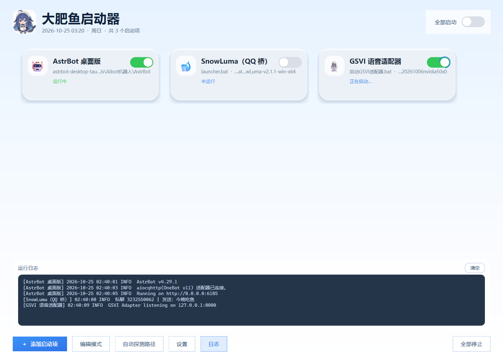

# 大肥鱼启动器（AstrBotLauncher）

一个给 Windows 用的本地程序启动管理器。把 **AstrBot、QQ 桥、语音适配器**这类需要按顺序启动的程序
登记成卡片，一键 / 按顺序启停，自带全屏避让、进程避让、启动接管、崩溃自动重启。

> **⬇ [下载最新版](https://github.com/xiaoshunserendipity/dafish-launcher/releases/latest)** —— Windows 10 / 11 64 位，解压即用，无需安装 Python



**启动器打开时不会主动启动任何程序** —— 所有开关默认关闭，状态永不落盘。

---

## 特性

| 分类 | 能力 |
|---|---|
| **启动** | 单个启停 / 总开关按顺序级联（等上一个真正就绪再下一个）/ 延迟启动 / 端口预检 / 就绪端口 |
| **便携** | 配置、日志全在 exe 同目录；程序目录内的路径自动记成 `${APP}\...`，整个文件夹搬走仍有效 |
| **窗口形态** | 正常窗口 / 最小化到任务栏 / 后台运行（不弹窗，输出进日志面板），每张卡片独立设置 |
| **自动打开网页** | 服务起来后自动用浏览器打开地址，三级兜底：就绪端口 → 手填地址 → 从输出抓；只放行本机/局域网 |
| **状态感知** | 全屏避让、目标进程避让（只恢复被自动暂停的条目）、启动时接管已在运行的服务 |
| **稳定性** | 单实例保护、崩溃自动重启（最多连续 5 次）、崩溃日志 `crash.log`、日志按大小轮转 |
| **界面** | 米家风格的浅蓝渐变卡片、拖拽排序、托盘常驻、可折叠日志面板、诊断包导出 |

支持的启动目标：`.exe` / `.com` / `.bat` / `.cmd` / `.lnk`，数量不限。
（`.lnk` 交给系统 Shell，只能启动一次，状态无法跟踪。）

---

## 快速开始

### 直接用（免安装）

下载 Releases 里的 `大肥鱼启动器-vX.Y.Z-便携版.zip`，解压到**有写权限的普通文件夹**（别放 `C:\Program Files`），双击 exe。

首次运行会在同目录生成 `config.json`、`detect_rules.json`、`logs\`。
卡片路径先留空，点「设置」选目标程序，或点底部「自动探测路径」。

### 从源码运行

```bat
C:\Python\python.exe -m venv .venv
.venv\Scripts\python.exe -m pip install -r requirements.txt
.venv\Scripts\python.exe launcher.py
```

### 打包

```bat
build.bat
```

手动等价命令：

```bat
.venv\Scripts\pyinstaller.exe --noconfirm --clean --onefile --noconsole ^
    --name "AstrBotLauncher" --icon "assets\app.ico" ^
    --version-file "version_info.txt" --add-data "assets;assets" ^
    --hidden-import psutil launcher.py
```

产物 `dist\AstrBotLauncher.exe`，改名成 `大肥鱼启动器.exe` 即可分发。

### 自检

```bat
.venv\Scripts\python.exe launcher.py --selftest
```

80 项检查，覆盖进程启停、日志捕获、接管、自动重启、避让状态机、配置迁移、URL 识别等。

---

## 便携模式

| 情况 | 配置存哪 |
|---|---|
| exe 在可写目录（普通文件夹 / U 盘 / 桌面） | exe 同目录（便携模式） |
| exe 在不可写目录（`Program Files`、只读介质） | 自动降级到 `%LOCALAPPDATA%\大肥鱼启动器` |
| 设置了环境变量 `LAUNCHER_CONFIG` | 该变量指定的路径 |

程序目录内的路径保存时自动转成 `${APP}\...`：

```json
{
  "name": "AstrBot 桌面版",
  "path": "${APP}\\AstrBot\\astrbot-desktop-tauri.exe",
  "cwd":  "${APP}\\AstrBot"
}
```

`${APP}` 在运行时展开成 exe 所在目录，所以只要文件夹内部结构不变，搬到任何路径、任何电脑都不用重新设置。

推荐的目录布局：

```
我的AI工具\
├─ 大肥鱼启动器.exe
├─ config.json
├─ AstrBot\
│  └─ astrbot-desktop-tauri.exe
└─ SnowLuma\
   └─ launcher.bat
```

---

## 配置结构（version 6）

```json
{
  "version": 6,
  "items": [
    {
      "id": "a1b2c3d4e5f6",
      "name": "SnowLuma（QQ 桥）",
      "path": "${APP}\\SnowLuma\\launcher.bat",
      "args": "",
      "cwd": "${APP}\\SnowLuma",
      "window": "hidden",
      "icon": "🐋",
      "delay_seconds": 3,
      "auto_restart": true,
      "check_port": 0,
      "avoid_fullscreen": true,
      "avoid_process": true,
      "ready_port": 5099,
      "ready_timeout": 60,
      "auto_open": true,
      "open_url": "",
      "group": "",
      "allow_adopt": true
    }
  ],
  "settings": {
    "autostart": false,
    "close_to_tray": true,
    "fullscreen_avoid": true,
    "adopt_on_startup": true,
    "theme": "auto"
  },
  "targets": []
}
```

| 字段 | 说明 |
|---|---|
| `window` | `normal` 正常窗口 / `minimized` 最小化到任务栏 / `hidden` 后台运行不弹窗 |
| `delay_seconds` | 0–600，总开关轮到它之后再等这么久 |
| `auto_restart` | 非用户主动关闭的退出，3 秒后自动重启，连续 5 次失败则停 |
| `check_port` | 0 = 不检测；否则启动前探测 `127.0.0.1:端口`，被占用会询问 |
| `ready_port` | 就绪端口：端口通了才算启动完成（顺序启动靠它判断） |
| `auto_open` / `open_url` | 启动后自动打开网页；地址优先级 就绪端口 > `open_url` > 输出抓取 |
| `allow_adopt` | 启动时自动接管已在运行的同名进程 |
| `avoid_fullscreen` / `avoid_process` | 是否参与全屏避让 / 目标进程避让 |

旧版本配置会自动迁移（v2 → v6），不会丢数据。

---

## 自动打开服务地址

服务启动后会打印类似 `[WebUI] listening http://127.0.0.1:5099` 的地址，可以让启动器自动打开。

**优先级**：就绪端口 → 手填地址 → 从控制台输出里抓。

第三级只在「后台运行」形态下有效 —— 正常/最小化时输出直接进控制台，启动器读不到。

**安全限制**：只放行 `localhost`、`127.x`、`10.x`、`172.16–31.x`、`192.168.x`、`::1`。
输出里出现外部网址会被拒绝并记入日志 —— 因为批处理输出不可信。

---

## 代码结构

| 文件 | 职责 |
|---|---|
| `launcher.py` | 入口：单实例、命令行参数、崩溃钩子 |
| `app/mainwindow.py` | 主窗口：卡片编排、总开关级联、避让状态机、自动打开网页 |
| `app/processes.py` | 进程管理核心：启动、停止、接管、自动重启、端口检测 |
| `app/config.py` | 数据模型、序列化、版本迁移 |
| `app/paths.py` | 数据目录探测、`${APP}` 变量 |
| `app/card.py` / `switch.py` / `flow.py` / `theme.py` | 卡片控件、动画开关、流式布局、主题样式 |
| `app/dialogs.py` | 启动项设置、全局设置、触发器设置 |
| `app/fullscreen.py` / `monitor.py` | 全屏检测、目标进程监控线程 |
| `app/adopt.py` | 启动接管：识别已运行的同名进程 |
| `app/detect.py` | 自动探测路径（规则外置到 `detect_rules.json`） |
| `app/weblink.py` | URL 识别、本机地址校验、调用浏览器 |
| `app/logreader.py` / `logfile.py` | 子进程输出读取线程、按大小轮转的日志写入器 |
| `app/crashlog.py` | 崩溃日志：`excepthook` + `faulthandler` + Qt 消息处理器 |
| `app/single_instance.py` | 基于文件锁 + 命名管道的单实例 |
| `app/autostart.py` | 开机自启（`HKCU\...\Run`） |
| `app/housekeeping.py` | 清理 PyInstaller 遗留的 `_MEI*` 临时目录 |
| `app/selftest.py` | 80 项自检 |

---

## 已知限制

- **未做代码签名**：首次运行会弹 SmartScreen 提示，杀毒软件可能误报，需手动放行
- **仅支持 Windows 10 / 11 64 位**（32 位、ARM64、Win7 不支持）
- **`.lnk` 无法跟踪状态**：交给系统 Shell 启动，启动器只知道它被拉起过
- **`.py` / `.ps1` / `.vbs` 不能直接选**：Windows 不当作可执行文件，包一层 `.bat` 即可
- **必须使用 PySide6 6.11.2**（`requirements.txt` 已锁死）—— 实测 6.12.0 在本项目里退出时会随机崩溃
- **单文件冷启动 1–3 秒**：PyInstaller 解压开销，属正常现象

---

## 文档

- [用户指南](docs/用户指南.md) —— 完整使用说明、便携规则、窗口形态、排障、分发清单
- [使用说明.txt](docs/使用说明.txt) —— 随包附带的快速上手
- [CHANGELOG.md](CHANGELOG.md) —— 版本变更记录

---

## 素材来源

内置**开机动画**转码自 [Something11235/dsh-video-skin](https://github.com/Something11235/dsh-video-skin)（MIT）的 `boot.mp4`：

```
1280×720 / 8.06s MP4  →  900×506 / 2.0s 动态 WebP（截 0–6s，加速 3×）
```

动画**可以自己换**：把 `boot.webp` / `boot.gif` 放到 exe 同目录即可，不用重新打包。
完整说明见 [THIRD_PARTY_NOTICES.md](THIRD_PARTY_NOTICES.md)。

---

## 许可

[MIT](LICENSE)
